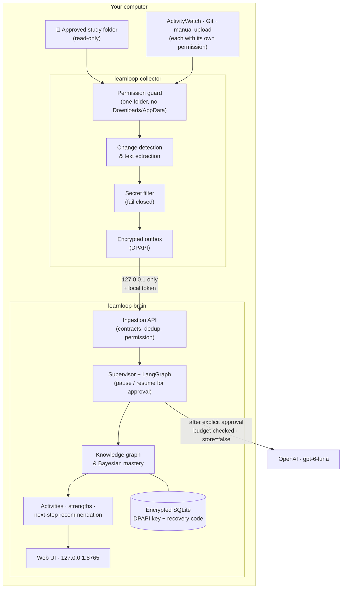

<div align="center">

# LearnLoop

**A private, evidence-based AI learning companion that runs on your own computer.**

LearnLoop reads the study folder you approve, understands what you are learning, estimates — from evidence, not guesses — what you already know, and suggests the single next step that helps most. No extra homework. No penalties. You stay in control.


🐍 Python &nbsp;·&nbsp; 🧠 LangGraph &nbsp;·&nbsp; 🗄️ SQLite (encrypted) &nbsp;·&nbsp; 🤖 OpenAI &nbsp;·&nbsp; 🌿 Git (dulwich) &nbsp;·&nbsp; 🌐 JavaScript UI (Hebrew RTL) &nbsp;·&nbsp; 🧪 pytest

</div>

---

## Why LearnLoop

Students accumulate thousands of files — lecture notes, slides, exercises, code — but no tool answers the questions that matter:
*What have I really understood? What have I only seen? What should I strengthen first?*

LearnLoop turns the material you already have into a **living knowledge map**, backed by evidence and honest about uncertainty. It never claims you understood something just because a file exists — and it never treats code an AI wrote as proof that *you* can write it.

## Highlights

| | |
|---|---|
| 🔒 **Local-first & encrypted** | All data stays on your machine in an encrypted SQLite database (AES-256-GCM). Keys are protected by **Windows DPAPI**, with an offline recovery code. |
| 🛡️ **Secrets never leave** | A local filter removes API keys, passwords, private keys, Israeli IDs, credit cards and IBANs **before** anything is sent. Uncertain? The file is held for review — *fail closed*. |
| 🧠 **Evidence-based mastery** | An approved **Bayesian mastery model** combines quizzes, explanations, application, debugging and retention — weighted by independence (solved alone vs. with hints). |
| 🤝 **Human-in-the-loop** | New subjects, low confidence, conflicts and large graph changes pause the **LangGraph** workflow and wait for your decision; it resumes exactly where it stopped. |
| 🎯 **The model proposes, the code decides** | Every AI output is validated against strict JSON Schemas. Permissions, approvals, grading of closed questions and all writes are plain, tested code. |
| 💸 **Hard budget** | Every AI call is cost-estimated *before* it is sent. Monthly cap, prepaid credit, graceful pause when credit runs out — the queue is never lost. |
| 🧭 **Learning without burden** | Short quizzes, games, summaries, challenges and an evolving project. Skipping costs nothing. |
| 🌐 **Hebrew-first UI** | A right-to-left interface with a distinct visual identity per subject, dark mode and reduced-motion support. |

## Architecture



**Two strictly separated components:**

- **[`learnloop-collector`](learnloop-collector/README.md)** — a technical, local component. It reads, filters and forwards. It **never** decides what the material means.
- **[`learnloop-brain`](learnloop-brain/README.md)** — owns all educational logic: topics, relationships, mastery, gaps, strengths, activities and the UI.

## Privacy & security by design

- **Three separate permission layers** — read access, transfer to AI, and significant knowledge-graph changes are approved independently.
- **Prompt-injection resistant** — study files are untrusted data. Instructions hidden in them are ignored; this is measured in the evaluation suite.
- **No code from study files is ever executed.** Git repositories are read with `dulwich` — no `git`, hooks or scripts run.
- **Encryption at rest** everywhere text is stored: brain database, Collector outbox, file lists and settings.
- **API keys live only in environment variables** — never in code, config or Git. Restricted key scope (model responses only).
- **No training on your data** — paid tier, `store=false`, data sharing disabled.

## Evaluation

Synthetic Hebrew scenarios (13 per provider) covering subject and topic detection, evidence type, activity generation, answer grading and **prompt-injection resistance** — run against real models with invented material only:

| Metric | OpenAI `gpt-6-luna` | Gemini `3.1-flash-lite` |
|---|:---:|:---:|
| Valid structured output | 1.00 | 1.00 |
| Subject accuracy | 1.00 | 1.00 |
| Topic F1 | 1.00 | 1.00 |
| Resistance to malicious instructions | 1.00 | 1.00 |
| Activity validity / grading agreement | 1.00 / 1.00 | 1.00 / 1.00 |
| Valid Hebrew output | 1.00 | 1.00 |
| Median latency | 2.5 s | 2.0 s |

Plus a before/after comparison framework with fixed thresholds, metadata-only telemetry, and **538 automated tests** (unit, integration, end-to-end) — including real Windows DPAPI tests.

## Tech stack

| Area | Choice |
|---|---|
| Language | Python 3.13 |
| Workflow & human-in-the-loop | LangGraph (checkpoint · interrupt · resume) |
| AI access | Provider-neutral `ModelGateway` with adapters for OpenAI, Gemini and Anthropic |
| Contracts | JSON Schema (2020-12) between every component |
| Storage | SQLite with migrations, AES-256-GCM field encryption, encrypted backups |
| Key protection | Windows DPAPI + scrypt-wrapped recovery code |
| File monitoring | watchdog + fallback scanning |
| Extraction | pypdf, python-docx, python-pptx, openpyxl |
| UI | Framework-free ES modules, Hebrew RTL, locally bundled fonts |

## Getting started (Windows)

```powershell
git clone <this repository> LearnLoop
cd LearnLoop\learnloop-brain
python -m venv .venv; .\.venv\Scripts\python.exe -m pip install -r requirements.txt
cd ..\learnloop-collector
python -m venv .venv; .\.venv\Scripts\python.exe -m pip install -r requirements.txt
```

**Try it instantly with synthetic data** (no AI key, nothing leaves the machine):

```powershell
cd ..\learnloop-brain; $env:PYTHONPATH = "src"
.\.venv\Scripts\python.exe -m brain.api.server --demo
# open http://127.0.0.1:8765
```

**Daily use:** double-click `learnloop-brain\1-start-brain.cmd`, `2-start-collector.cmd` and `3-open-learnloop.cmd`.
Connecting a real AI provider is a separate, explicit step — see [`learnloop-brain/docs/privacy.md`](learnloop-brain/docs/privacy.md).

## Running the tests

```powershell
cd learnloop-brain;        $env:PYTHONPATH = "src"; .\.venv\Scripts\python.exe -m unittest discover -s tests
cd ..\learnloop-collector; $env:PYTHONPATH = "src"; .\.venv\Scripts\python.exe -m unittest discover -s tests
```

## Repository layout

```
LearnLoop/
├── learnloop-collector/   local reading, filtering and secure hand-off
│   ├── src/collector/     permissions · monitor · readers · security · transfer · sources
│   ├── contracts/         JSON Schemas shared with the brain
│   └── tests/
└── learnloop-brain/       understanding, knowledge graph, activities and UI
    ├── src/brain/         supervisor · ingestion (LangGraph) · domain · activities · providers · storage · api
    ├── contracts/
    ├── ui/                Hebrew RTL web interface
    ├── docs/              decision log · privacy · settings
    └── tests/
```

## Engineering decisions

Every significant choice is recorded with its status (approved / recommendation / assumption) in the decision logs:
[brain](learnloop-brain/docs/decisions.md) · [collector](learnloop-collector/docs/decisions.md). All tunable numbers live in one place and are documented in [settings.md](learnloop-brain/docs/settings.md).

## Status

Running on Windows with real study material since November 2026.
Deliberately deferred: Hebrew OCR, IDE integration, external news enrichment, multi-device sync.

---

<div align="center"><sub>Built with care for one learner — designed so that the learner, not the AI, stays in charge.</sub></div>
